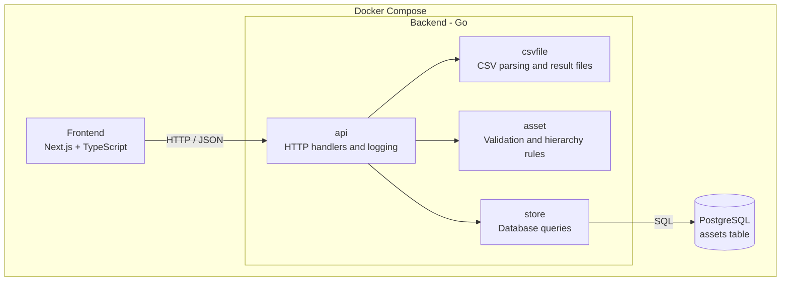

# Smart Grid

A full stack web app for importing electrical grid assets data from csv files and displaying the uploaded data.

Built with **Next.js, TypeScript, Go and PostgreSQL**.

**Live demo:** https://smartgrid.istodaychristmas.com

| Username | Password |
|---|---|
| `reviewer` | sent by email |

The supplied data is already imported. The password only keeps strangers out of the demo; it is not part of the app.


## 1. Features

**Import**
- Upload a CSV file and see every error and warning by line.
- Checks fields, duplicate IDs, parent-child rules and cycles.
- Download the valid and invalid rows as separate files.
- Save the valid rows to PostgreSQL in one transaction: all rows or none.
- Delete all stored assets from the upload page, after a warning, to start again.

**Explore**
- Expandable hierarchy tree, from substations down to switchboard panels.
- Asset details with parent, children grouped by type and counts of everything beneath.
- Asset lists, all together or by type.

**Search**
- Find assets by part of their ID or name.
- Choosing a result opens the asset, expands the tree to it and highlights it.
- Every asset has its own address, which survives a refresh.

**Logging**
- The backend logs every request it receives: what was asked for, the result and how long it took.
- When something fails on the server, the log says why.
- Every validation and import is logged with its file name and row counts.
- An error shown in the app ends with a reference, which finds that failure in the logs.

## 2. Where to Find Each Requirement

| Criterion | In the app | In the code |
|---|---|---|
| CSV validation | Upload a file at `/` | [validate.go](backend/internal/asset/validate.go), [stored.go](backend/internal/asset/stored.go) |
| Agentic workflow | | [AI_JOURNAL.md](AI_JOURNAL.md), [AGENTS.md](AGENTS.md) |
| Frontend | Hierarchy tree at `/explorer`, lists at `/assets` | [assets/](frontend/components/assets/), [csv-upload/](frontend/components/uploads/csv-upload/) |
| PostgreSQL and hierarchy | | [001_create_assets.sql](backend/migrations/001_create_assets.sql), [store.go](backend/internal/store/store.go) |
| Backend and API | Endpoints in section 8 | [main.go](backend/main.go), [api/](backend/internal/api/) |
| Search | Search bar at `/explorer` | `SearchAssets` in [store.go](backend/internal/store/store.go), [asset-search.tsx](frontend/components/assets/asset-search/asset-search.tsx) |
| Logging | `docker compose logs backend` | [logging.go](backend/internal/api/logging.go), [api.go](backend/internal/api/api.go) |
| Unit tests | `docker compose run --rm test` | `*_test.go` files in [backend/](backend/) |
| Infrastructure | `docker compose up --build` | [compose.yaml](compose.yaml), [scripts/](scripts/) |
| Cloud hosting (bonus) | https://smartgrid.istodaychristmas.com | [compose.prod.yaml](compose.prod.yaml), [Caddyfile](Caddyfile), [.env.example](.env.example) |
| Documentation | | This README |

## 3. Getting Started

**Run with Docker** (requires only Docker)

```bash
docker compose up --build
```

Open http://localhost:3000. Reset the data with `docker compose down -v`.

If port 5432 is already in use: `DB_PORT=5433 docker compose up --build`

**Develop locally** (requires Docker, Go and Node.js)

```bash
./scripts/setup.sh   # once: starts the database, applies migrations, installs dependencies
./scripts/dev.sh     # frontend on :3000, backend on :8080
```

**Import the supplied data**

The supplied file is in the repository as [grid_assets.csv](grid_assets.csv).

1. Open http://localhost:3000 and choose `grid_assets.csv`.
2. Click **Validate**. Nothing is saved yet. The page should report:
   - 205 lines can be committed.
   - 17 lines have errors, each listed with its line number and reason.
   - 2 warnings, for a serial number used twice.
3. Click **Commit Valid Rows**. The page should report that 205 rows were committed.
4. Open **Explorer**. The tree should show 13 substations.

The 17 rejected rows are the ones in the file that break a rule:

| Lines | Problem |
|---|---|
| 91, 92 | The parent does not exist |
| 93 to 97 | Circular parents |
| 98, 99 | Wrong type of parent |
| 178 | Unsupported asset type |
| 179 | Invalid date |
| 180 | Negative rating |
| 181 | Unsupported status |
| 182 | Missing asset ID |
| 183 | Missing asset name |
| 184 | A substation with a parent |
| 185 | No parent |

Uploading the same file again commits nothing: every row that was saved is reported as already in the database.

**Sample CSV files** (requires Go)

```bash
./scripts/auto-generate-csvs.sh
```

This writes five files to upload into the `generated-csv` folder, each with 3 substations and 48 assets:

| File | What is wrong with it | What the app should do |
|---|---|---|
| 1. Valid | Nothing | Accept every row |
| 2. Field errors | Missing names, unsupported statuses, bad dates, negative ratings | Reject those rows |
| 3. Hierarchy errors | Parents not found, wrong types of parent, an asset that is its own parent, circular parents | Reject those rows |
| 4. Duplicates | Repeated asset IDs and repeated serial numbers | Reject the repeated IDs; warn about the serial numbers |
| 5. Missing column | One column removed | Reject the whole file |

Next to each file is an answer sheet (`..._answers.txt`) that lists the changed lines and what the app should report for each. Every run uses new asset IDs, so the files never clash with assets already stored.

## 4. Running Tests

```bash
docker compose run --rm test   # with Docker
./scripts/test.sh              # locally
```

Unit tests cover validation rules, cycle detection, hierarchy checks, checks against stored assets, CSV generation and logging.

## 5. Tech Stack

| Component | Technology |
|---|---|
| Frontend | Next.js, TypeScript, Tailwind CSS |
| Backend | Go (`net/http`) |
| Database | PostgreSQL |
| Testing | Go standard `testing` package |

## 6. Architecture



Each box in the diagram links to its code. The same links: [frontend](frontend/), [api](backend/internal/api/), [csvfile](backend/internal/csvfile/), [asset](backend/internal/asset/), [store](backend/internal/store/), [schema](backend/migrations/001_create_assets.sql), [compose.yaml](compose.yaml).

Only the backend talks to the database, and `asset` contains no HTTP or SQL, so the validation rules are tested on their own.

## 7. Asset Explorer and Search

**Explorer** (`/explorer`)
- The tree on the left starts with the substations. Opening an asset shows the assets beneath it.
- Selecting an asset shows its details on the right: its fields, its parent, its children grouped by type, and how many assets of each type are beneath it.
- Each asset has its own address, `/explorer/{asset_id}`. Opening that address directly, or refreshing, opens the tree down to the asset and highlights it.

**Search**
- The search bar is above the tree. Press `/` to jump to it.
- It matches any part of an asset's ID or name, ignoring case, and lists the first 20 matches as you type.
- Choosing a result opens the asset's page, opens the tree down to it, highlights it in the tree and shows its details, with the matched text marked.

**Asset lists** (`/assets` and one page per type)
- Cards for every asset, with counts by type and status. More load as you scroll.

Every view shows a message while loading, when there is nothing to show and when the backend cannot answer.

## 8. API Endpoints

| Method | Endpoint | Description |
|---|---|---|
| POST | `/api/validate` | Validate CSV and generate results |
| POST | `/api/imports` | Commit validated records |
| GET | `/api/assets` | List assets, optionally of one type and a page at a time |
| DELETE | `/api/assets` | Delete every stored asset, to start again |
| GET | `/api/assets/search?q=...` | Find assets whose ID or name contains the text |
| GET | `/api/assets/{assetId}` | Asset details, parent, immediate children, ancestors and descendant counts |

**Listing assets**

`GET /api/assets` takes three optional query parameters, which can be combined:

| Parameter | Meaning | Example |
|---|---|---|
| `type` | Only assets of this type: `SUBSTATION`, `TRANSFORMER`, `LV_BOARD`, `SWITCHBOARD` or `SWITCHBOARD_PANEL` | `type=TRANSFORMER` |
| `limit` | At most this many assets, from 1 to 100 | `limit=20` |
| `after` | Continue after this asset ID, taken from the previous response's `next_after` | `after=TX-001-2` |

```bash
# Every asset
curl "http://localhost:8080/api/assets"

# Only the substations
curl "http://localhost:8080/api/assets?type=SUBSTATION"

# The first 20 transformers
curl "http://localhost:8080/api/assets?type=TRANSFORMER&limit=20"

# The next 20, where the previous response ended with "next_after": "TX-001-2"
curl "http://localhost:8080/api/assets?type=TRANSFORMER&limit=20&after=TX-001-2"
```

Assets are ordered by ID. `next_after` is `null` on the last page, and an unsupported `type` returns a 400 that lists the supported ones.

**Searching assets**

`GET /api/assets/search?q=...` returns the assets whose ID or name contains the text in `q`. Upper and lower case are treated the same.

```bash
# By name: finds "Aurora Panel A1"
curl "http://localhost:8080/api/assets/search?q=panel"

# By ID: finds "PNL-001-1-01"
curl "http://localhost:8080/api/assets/search?q=pnl-001"
```

It returns the first 20 matches, ordered by ID. `more` is `true` when more assets match than were returned.

## 9. Logging

The backend writes its logs to standard output, one line per event. See them with `docker compose logs backend`, or in the terminal that runs `./scripts/dev.sh`.

**What is logged**

| Event | Level | Contains |
|---|---|---|
| Server start | INFO | The database in use, with the password hidden |
| Every request | INFO, or WARN for a 4xx, or ERROR for a 5xx | Method, path, query, status and duration |
| A server failure | ERROR | What could not be done and the cause |
| A validation | INFO | File name, rows, errors and warnings |
| An import | INFO if committed, WARN if rejected | File name, rows and errors |
| A delete of all assets | WARN | How many assets were deleted |
| A crash in a handler | ERROR | The cause and where it happened. The server keeps running and answers with a 500. |

Every line for a request carries the same `request_id`. The contents of uploaded files are never logged, only the file name and counts.

## 10. Assumptions

Where the brief left a choice open, these are the assumptions the app is built on.

**The supplied file**
- The brief describes `grid_assets.csv` as a valid dataset of 220 assets. The file has 222 rows, and 17 of them break a rule in section 4.1, so the app imports 205 and rejects 17. I assumed those rows are deliberate test cases and that rejecting them is correct.
- Dates are day/month/year, because that is the format in the supplied file.

**Import**
- Partial import: the valid rows of a file can be saved while the invalid rows are rejected.
- An asset ID that is already stored is rejected, not updated. Editing assets is out of scope, and silently overwriting stored data would be riskier than refusing.
- When an asset ID appears more than once in a file, every row with that ID is rejected. The app cannot know which one is right.
- A duplicate serial number is a warning, not an error. The brief does not ask for serial numbers to be unique.
- The file must have exactly the eleven columns, in any order. A missing, extra or repeated column rejects the whole file before any row is checked.
- Asset types and statuses must match exactly, in capitals. `operational_status` is required, because an empty status is not a supported one.
- The other fields may be empty. Only `rating_kva` has a sign rule; `voltage_kv` only needs to be a number.
- Spaces around a value are ignored.
- A file is at most 10 MB, which is far above the supplied data and lets the whole file be checked in memory.

**Explorer and search**
- "Counts beneath it" means every asset under the selected one at any depth, counted by type.
- Search covers the asset ID and name. Searching by type is optional in the brief and is covered by the type pages.
- "The asset page" is `/explorer/{asset_id}`, which shows the tree and the details together.

**Users**
- One trusted user at a time. There is no authentication, and two imports running at the same moment were not designed for.

## 11. Design Decisions and Trade-offs

**Import**
- **Validate first, commit second.** The user sees every error before anything is saved. The cost is two uploads of the same data.
- **Partial import.** The valid rows can be saved without waiting for the rejected ones to be fixed. An asset is still never stored without its parent: the commit checks this again and the database enforces it.
- **Validated again on commit.** The import does not trust the earlier check: it validates every row again against the database, inside the transaction that saves them.
- **All rows or none.** One transaction per import. A failure part-way leaves the database as it was.

**Database**
- **One table.** Each asset stores the ID of its parent, which is how the hierarchy is kept.
- **The database enforces the rules too.** It refuses a row that breaks them, such as an asset without a parent.
- **One query for a whole branch.** An asset's ancestors, and the counts beneath it, each take a single query.
- **Indexes** on the parent and the serial number, to find children and duplicates quickly.
- **Search reads every row.** That is fast at this size. A large table would need a search index.

**API**
- **One call for an asset's details.** It returns the asset with its parent, children, ancestors and counts, so the page needs one request instead of four. There are no separate `/children` and `/ancestors` endpoints.
- **Paging by "after this ID"**, not by page number, so a page stays correct when assets are added.
- **Standard library only** for HTTP, CSV and logging. No framework and no ORM, so the SQL is in plain view.

**Frontend**
- **The tree loads one level at a time.** Opening an asset fetches its children. The first load is fast however large the hierarchy is, at the cost of a short wait on first opening an asset.
- **The address is the selection.** The selected asset is in the URL, so a link, a refresh and the back button all work.

## 12. Known Limitations

**Import**
- Assets that are already stored cannot be updated or deleted by an import.
- Validation loads every stored asset into memory, which would not suit a very large database.
- Dates must be day/month/year, as in the supplied file. Other formats are rejected.
- There is no record of past imports, only the log lines.

**Search and API**
- Search reads every row and returns at most 20 matches, ordered by ID, not by how well they match.
- Search covers the asset ID and name, not the type.
- Listing assets without `limit` returns all of them.
- A server error shows its technical cause to the user.

**Testing**
- The tests do not run against a real database, so the import transaction and the SQL queries are checked by hand only.
- There are no frontend tests.

**Other**
- No authentication, which is outside the assignment's scope. The hosted demo is protected only by one shared password at the web server in front of it.
- The sample file script needs Go installed.

## 13. Next Steps
